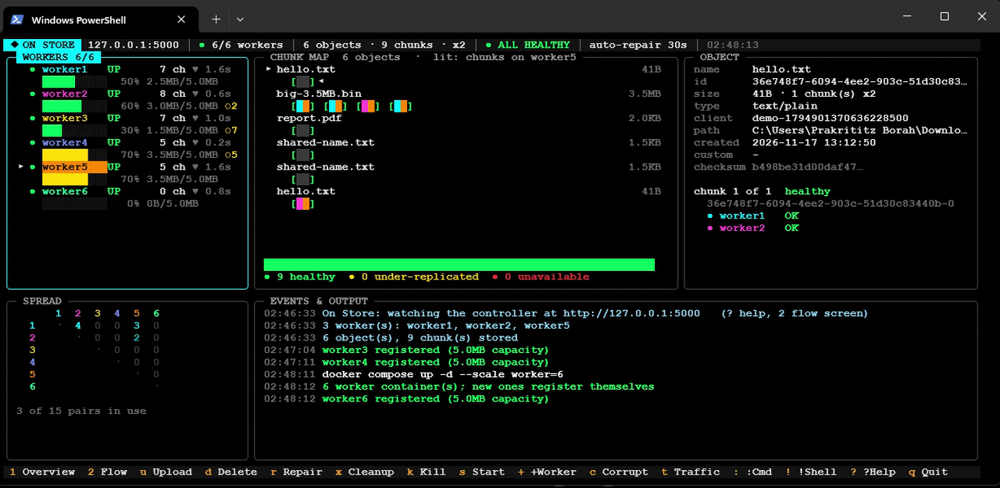
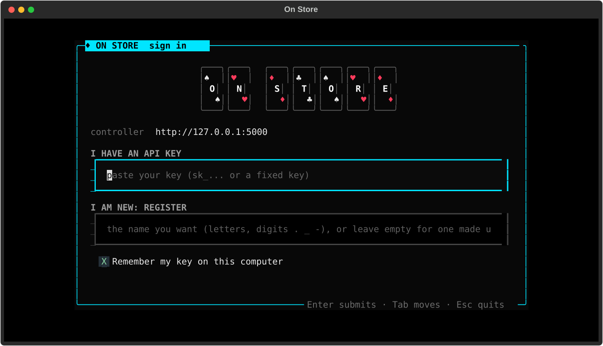
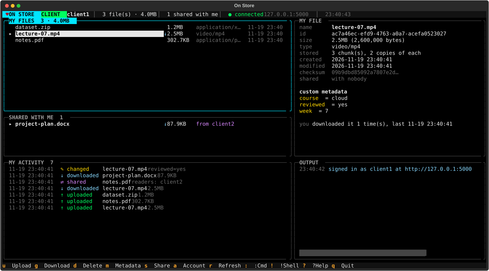

# Mini Distributed Object Store

A basic storage system where clients upload and retrieve files of any type
(documents, images, video, audio, archives, other binary data). A controller
splits each file into 1 MB chunks and stores every chunk on two different
workers (replication factor 2). It runs in Docker as 1 controller, any number
of workers (4 by default) and one or more clients.

Covers upload, download, delete, object metadata (including custom key-value
metadata), replication spread over the workers, worker registration and
heartbeats, corruption detection (checksums), manual and automatic repair,
orphan cleanup, persistent metadata, and a Docker Compose deployment.

**To run it and try everything yourself, see [GUIDE.md](GUIDE.md).**



**On Store** is a pair of terminal dashboards. Which one opens depends on the key you sign in with:

- **Admin** (a key named in `ADMINS`): every worker, every chunk and where
  its copies are, heartbeats, failures and repairs. Its keys also kill and
  start workers, upload, corrupt a copy and repair.
- **Client** (any other key): only that client's own files, the files other
  clients shared with it, and its own history of uploads, downloads, changes
  and shares. Nothing about the workers.

Without a key, a sign-in portal opens. There you type a key, or **register** as
a new client: the controller issues your key, the portal shows it once and
saves it, and your dashboard opens.

```
pip install -r dashboard/requirements.txt
docker compose up --build -d
python -m dashboard --key admin-dev-key      # the admin dashboard
python -m dashboard                          # sign in or register: your client dashboard
```

| Sign in or register | A client's dashboard |
|---|---|
|  |  |

See [dashboard/README.md](dashboard/README.md) for the screens and keys.

## Architecture

```
client(s) --HTTP--> controller (app.py: API + distributor) --HTTP--> worker x N (nodes/node_server.py)
                         |                                              |
                    metadata file                                  chunk files
                (controller-data volume)                       (worker-data volume)
```

The controller is the only component that knows where everything lives. Each
worker is its own server process with its own storage; workers never talk to
each other, and the controller writes every copy itself through a `RemoteNode`.

```
app.py  client.py  config.py  demo.py      entry points, settings, the demonstrations
docker-compose.yml                         the whole system in Docker (settings at the top)
Dockerfile.controller / .worker / .client  the three images (+ a .dockerignore each)
files/                                     files the client containers can upload (/files)
controller/                                everything that runs in the controller
  distributor.py  remote_node.py  metadata_store.py
nodes/                                     everything that runs in a worker
  node.py  node_server.py  identity.py
helpers/                                   small pieces both sides (and the client) use
  checksum.py  file_upload.py  errors.py
tests/                                     the test suite (needs no Docker)
```

| File | Role |
|---|---|
| `app.py` | Flask endpoints (client API and internal worker API); owns the distributor; runs automatic repair |
| `client.py` | The client: a menu, or one command per run (`python client.py upload FILE`) |
| `config.py` | Settings: chunk size, copies per chunk, metadata file, auto-repair grace, timeouts, heartbeats |
| `demo.py` | Runs the spec's demonstrations against the running system |
| `controller/distributor.py` | Chunking, placement, metadata, reassembly, health report, repair, auto-repair, orphan detection |
| `controller/remote_node.py` | `RemoteNode`: the controller's HTTP client for one worker |
| `controller/metadata_store.py` | Saves the metadata in a SQLite database (only the rows a change touches) and loads it on start; the older JSON file store is still there |
| `nodes/node_server.py` | One worker as its own Flask process, served by waitress; registers itself (once it is listening) and sends heartbeats |
| `nodes/identity.py` | How a worker started by Docker Compose finds its own id (worker1, worker2, ...) |
| `nodes/node.py` | `ChunkStore`: the worker's file-backed chunk storage, with checksums |
| `helpers/checksum.py` | `compute` / `verify`: the one checksum function (SHA-256) used everywhere |
| `helpers/file_upload.py` | Reads and saves files on disk as raw bytes |
| `helpers/errors.py` | `NodeUnavailable` and `ChunkCorrupt`, shared so the controller and the workers never import each other |

## How it works

**Upload:** the file is read `CHUNK_SIZE` bytes at a time, in order. Each chunk
gets `REPLICATION_FACTOR` copies on different live workers with room, written at
the same time, and up to `PARALLEL_CHUNKS` chunks (default 4) are being stored
at once; reading waits while all of them are busy, so the controller holds about
`PARALLEL_CHUNKS` chunks, never the whole file. The workers for each chunk are
chosen in reading order, so placement is the same as one chunk at a time. The
checksum of the whole file is built up as the chunks are read, so in their real
order however they finish, and compared with the client's at the end. The name and metadata are registered (and
saved) only after every copy of every chunk is stored and the checksum matches.
If anything fails (a copy cannot be stored: 503; the checksum is wrong: 400; the
client stops sending), every copy already written is deleted, so nothing
half-uploaded is ever visible and a chunk is never kept with fewer copies.

**Placement:** for each copy, prefer the worker that has shared the fewest
chunks with the workers already holding this chunk, then the one with the most
free space, then take turns. So the copies are spread over all pairs of
workers instead of fixed mirror pairs: losing any two workers loses only a few
chunks. A worker without room is never chosen.

**Registration:** the controller has no list of workers. Every worker calls
`POST /internal/workers/register` when it starts, with its id and address, and
is used from then on. A worker keeps trying until the controller answers, and
registers again if the controller has forgotten it (its heartbeat gets a 404).

**Heartbeats:** every worker sends `POST /internal/workers/heartbeat` every 2 s
with its capacity and free space. A worker silent for 6 s is treated as down.
Placement reads this table, so it sends no requests to the workers. A chosen
worker that turns out to be dead or full is skipped and the next one is tried.

**Connections:** the controller keeps a pool of open connections to each worker
and reuses them (HTTP keep-alive); the workers run on waitress, a production web
server that keeps connections open and answers with a fixed pool of threads. A
worker opens its port before it registers, so it is never reported alive before
it can be reached. The controller itself still runs on Flask's development
server for now: waitress reads a whole request body before handing it over,
which would stop raw uploads from reaching the workers while they arrive.

**Download:** streamed too: each chunk is read from the first copy that is up
and intact (checked against the checksum recorded at upload, falling back to
the other copy), sent, and dropped. While one chunk is being sent, the next
ones (up to `PARALLEL_CHUNKS`) are already being fetched, but they are sent
strictly in order. The response carries
`Content-Length` and `X-Checksum` (the checksum recorded at upload). Before
anything is sent, the controller checks that every chunk has a copy on a live
worker and reads the first chunk, so the usual failures are a clear 503. If a
later chunk turns out to have no good copy (say both copies were damaged on
disk), the response has already started: the connection is closed early, the
client sees fewer bytes than `Content-Length`, and `client.py` throws the
download away.

`client.py` streams as well: it uploads the file straight from disk, and
downloads into a temporary file next to the target, checksumming it on the way;
only if the size and checksum are right is it renamed into place, so a damaged
or incomplete download never replaces anything.

**Delete during a download:** the object disappears from the metadata at once
(new requests get 404), but its copies are deleted only when the downloads
already running have finished, so they are never cut off half-way. Cleanup
leaves those copies alone meanwhile.

**Transfers at once:** at most `MAX_TRANSFERS` uploads and downloads run at the
same time (503 with `Retry-After: 1` beyond that), so the controller's memory
stays bounded: about `PARALLEL_CHUNKS` chunks per transfer.

**Health:** `GET /api/v1/replication` reports each chunk as `healthy`,
`under_replicated` (still downloadable) or `unavailable`, and each copy as `ok`,
`down`, `missing` or `corrupt`.

**Repair:** brings every chunk back to `REPLICATION_FACTOR` good copies: it
reads a verified good copy and writes it to live workers that hold none. A
damaged copy on a live worker is deleted or overwritten; a copy on a worker that
is down is dropped once replaced. A chunk with no good copy is `unrecoverable`
(never invented); one that cannot get all its copies is `partial`. Only one
repair runs at a time (409 otherwise).
- **Automatic:** when a worker has been down for `AUTO_REPAIR_GRACE` seconds (30
  by default), the controller repairs by itself. A worker back within that time
  causes no copying. `/api/v1/replication` shows what it last did.
- **Manual:** `POST /api/v1/repair`.

**Orphans:** copies no object points to any more, for example old copies on a
worker that was down while its chunks were repaired elsewhere, or a delete that
could not reach a worker. `GET /internal/workers/<id>/chunks` compares what a
worker holds with the metadata (orphans and missing chunks).
`POST /api/v1/cleanup` deletes the orphans. It never lowers a chunk below the
required number of good copies: if a chunk is short of good copies and an
orphan of it is intact (it matches the recorded checksum), that copy is taken
back into the chunk's replica list ("adopted") instead of being deleted. It
never touches a chunk of an upload in progress or one younger than `min_age`
seconds (60 by default; the age is the time since the copy was written on that
worker), and it works only with saved metadata, since an empty in-memory
controller would see every chunk as an orphan.

**Persistent metadata:** the metadata is saved in a SQLite database at
`METADATA_PATH` (Docker: `/meta/metadata.db` in the `controller-data` volume)
and loaded on start, so restarting the controller keeps every object. SQLite is
a library inside the controller, not a separate server: the controller reads and
writes the file itself. Three tables hold one row per object, per chunk and per
copy; each change (an upload, a delete, a metadata update, one chunk's copies
after a repair) is one transaction that writes only its own rows, so its cost
does not grow with the number of objects stored, and a crash mid-change leaves
the previous state. The database also enforces the duplicate rule (one object
per client and path) and indexes the copies by worker. The controller keeps a
copy of the metadata in memory for reads. An existing `metadata.json` from the
older JSON store is imported on the first start; a `METADATA_PATH` ending in
`.json` still uses the JSON file. Workers it has not heard from yet count as
down until they register.

The file can be inspected with any SQLite tool, e.g.
`docker cp object-store-controller-1:/meta/metadata.db .` and then
`sqlite3 metadata.db "SELECT name, size FROM objects"`.

**Duplicates:** objects are identified by `object_id`; the file name is only
metadata. An upload is a duplicate if the same client (`client_id`) uploads the
same source path again (409). Different clients may use the same path, and the
same name from different folders is always fine. Uploads with no path (plain
`curl`) are never refused.

**Clients, keys and access:** with `API_KEYS` set (the Docker deployment sets
development keys for `client1`, `client2` and `admin`), every request to
`/api/v1` must carry `Authorization: Bearer <key>` (401 otherwise), and the
client is whoever the key belongs to, never what the request claims. Every
object has an owner (the client that uploaded it) and optionally readers:

| Who | May |
|---|---|
| the owner | download, read and change the metadata, delete, choose the readers |
| a reader (`PUT /objects/<id>/readers`) | download and read the metadata (403 for changes) |
| an admin (`ADMINS`) | everything, including `/nodes`, `/replication`, `/repair`, `/cleanup` and a worker's chunk list (403 for others) |
| anyone else | nothing: the object answers 404, exactly as if it did not exist, and is not listed |

Without `API_KEYS` there is no authentication: everyone may do everything, as
before (`AUTH=1` turns it on with no fixed keys at all). The workers' own
endpoints (registration, heartbeats) need no key.

**Clients register themselves:** with authentication on, a new client needs no
key from anyone. It asks the controller for an account and gets its own key:

```
python client.py register client7          # or without a name: one is made up
Registered as 'client7'.
Your API key (shown only this once): sk_Xq3…
Saved to ~/.objectstore/credentials.json; this client uses it from now on.
python client.py upload notes.txt          # as client7
```

- `POST /api/v1/clients` (`{"client_id": "client7"}`, optional) needs no key.
  The controller creates a random key, returns it **once**, and keeps only its
  SHA-256 hash (in the `clients` table of the metadata database), so a lost key
  cannot be recovered. Registrations survive a restart.
- A name that already means someone is refused (409): a client of `API_KEYS`, an
  admin, a registered client, or the owner of stored objects. Otherwise
  registering as `admin`, or as the owner of older objects, would hand over
  their rights or their files.
- At most `REGISTRATIONS_PER_MINUTE` (10) registrations per network address
  (429 beyond), so one script cannot create thousands of accounts.
- A registered client is like any other: it sees only its own objects and has
  its own fair share. `client.py` keeps the key in
  `~/.objectstore/credentials.json` (readable only by its owner; one entry per
  API address; override with `OBJECTSTORE_CREDENTIALS`); `API_KEY`, when set,
  wins.
- `ALLOW_REGISTRATION=0` turns it off.

**A fair share for every client:** with authentication, no client can take
the system for itself:
- at most `MAX_TRANSFERS_PER_CLIENT` (8) of the `MAX_TRANSFERS` (32) uploads
  and downloads belong to one client; more get 503 with `Retry-After`, while
  other clients still get through;
- each client may send `RATE_PER_CLIENT` (20) requests per second, in bursts of
  up to `RATE_BURST` (40) (a token bucket per client); more get 429 with
  `Retry-After`;
- each client may store `QUOTA_PER_CLIENT` bytes (0: no limit; admins have
  none). An upload that would go over is refused with 413: at once when its
  size is known, otherwise as soon as it passes the quota, with everything
  stored for it deleted. Uploads running at the same time are counted
  together, and deleting frees quota.

`GET /api/v1/me` shows who the caller is, what it stores and its limits.
`GET /api/v1/me/activity` lists what the caller did, newest first: its uploads,
downloads, deletes, metadata changes and shares, from any program it used.
Each client sees only its own. The latest 500 per client are kept, in the
`activity` table of the metadata database, so they survive a restart. This
is what the client dashboard shows as "my activity" and "downloaded".

## Metadata

`object_id`, `name`, `size`, `content_type`, `created_at`, `modified_at`,
`checksum`, `source_path`, `client_id`, the chunk list (index, id, size,
checksum and the workers holding each copy) and `custom` key-value pairs. `PATCH` adds,
changes or (with `null`) removes custom keys; the stored data is never touched.

```
GET /api/v1/objects/<object_id>/metadata
{ "object_id": "3f2a...", "name": "movie.mp4", "size": 3145737, "content_type": "video/mp4",
  "created_at": "2026-11-15T10:12:03Z", "modified_at": "2026-11-15T10:12:03Z",
  "checksum": "ab12...", "chunk_count": 4, "copies_per_chunk": 2,
  "chunks": [{"index": 0, "chunk_id": "...-0", "size": 1048576, "checksum": "...",
              "replicas": ["worker1", "worker3"]}, ...],
  "custom": {"project": "demo"} }
```

## API

| Method | Endpoint | Purpose | Errors |
|---|---|---|---|
| POST | `/api/v1/objects` | Upload, two ways (below). Optional fields: `metadata` (JSON object), `checksum`, `path`, `client_id`, `size`. 201 with the metadata | 400 bad field / checksum mismatch / upload cut off, 403 `client_id` not the key's, 409 same client + path, 413 over the quota, 503 not enough room on enough live workers or `MAX_TRANSFERS` (or the client's share) busy |
| GET | `/api/v1/objects` | List objects (with authentication: own and shared ones, with their `owner`); optional `limit`, `offset`; total in `X-Total-Count` | 400 |
| GET | `/api/v1/objects/<id>` | Download, streamed: the original bytes, with the content type, `Content-Length` and an `X-Checksum` header | 404, 503 (no live copy of a chunk, or busy) |
| GET | `/api/v1/objects/<id>/metadata` | The object's metadata (`readers` shown to the owner) | 404 |
| PATCH | `/api/v1/objects/<id>/metadata` | Add/update custom metadata (`null` removes a key). Owner only | 400, 403, 404 |
| DELETE | `/api/v1/objects/<id>` | Delete the object and all copies, 204. Owner only | 403, 404 |
| GET / PUT | `/api/v1/objects/<id>/readers` | Who else may read it: `{"readers": ["client2"]}` (`[]`: nobody). Owner only | 400, 403, 404 |
| POST | `/api/v1/clients` | Register a new client (no key needed): `{"client_id": "..."}` (optional). 201 `{client_id, api_key}`, the key shown only once | 400 bad name, 404 registration off, 409 name taken, 429 too many from this address |
| GET | `/api/v1/me` | Who the caller is (`registered`: a self-registered client), its stored bytes, quota and limits | |
| GET | `/api/v1/me/activity` | What the caller did, newest first: `{at, action, object_id, name, size, detail}`, action one of upload / download / delete / metadata / share / register; `?limit=` (default 50, at most 500) | 400 |
| GET | `/health` | The controller is up (Docker's healthcheck); needs no key | |
| GET | `/api/v1/nodes` | Workers: up/down, capacity, used, free, chunks, seconds since the last heartbeat. Admin | 403 |
| GET | `/api/v1/replication` | Health of every chunk and copy; `auto_repair` status. Admin | 403 |
| POST | `/api/v1/repair` | Repair now; returns what was done. Admin | 403, 409 already running |
| POST | `/api/v1/cleanup` | Delete orphaned copies; `?min_age=` seconds (default 60). Admin | 400, 403, 409 no saved metadata / repair running |
| POST | `/internal/workers/register` | Sent by a worker when it starts: `worker_id`, `url`, `capacity`, `used`, `free`, `chunks`. 201 new, 200 known | 400 |
| POST | `/internal/workers/heartbeat` | Sent by a worker every 2 s: `worker_id`, `capacity`, `used`, `free`, `chunks` | 400, 404 not registered |
| GET | `/internal/workers/<id>/chunks` | What the worker holds vs the metadata: `held`, `expected`, `orphans`, `in_progress`, `missing`. Admin | 403, 404, 503 unreachable |

Errors are always JSON: `{"error": "..."}`. With authentication, every
`/api/v1` request can also get 401 (no or wrong key) and 429 (too many
requests). The workers' own endpoints (`/internal/chunks/...`,
`/internal/health`) are used only by the controller.

The two ways to upload:

```
# multipart form, the file in the 'file' field (what curl -F and HTML forms send).
# The web server first writes the whole upload to a temporary file, then it is read chunk by chunk.
curl -H "Authorization: Bearer client1-dev-key" \
     -F "file=@movie.mp4" -F 'metadata={"project": "demo"}' http://localhost:5000/api/v1/objects

# raw: the body is the file, the fields go in the query string ('name' required),
# Content-Type is the object's type. Chunks go to the workers while the body is arriving.
# This is what client.py sends.
curl -X POST -T movie.mp4 -H "Content-Type: video/mp4" -H "Authorization: Bearer client1-dev-key" \
     "http://localhost:5000/api/v1/objects?name=movie.mp4"
```

## Integrity checks (checksums)

| Where | What is checked | If it fails |
|---|---|---|
| Client -> controller | The client sends the file's checksum; the controller builds up the checksum of what arrives, chunk by chunk, and compares at the end | 400, everything stored is deleted |
| Controller -> client | The download carries `X-Checksum` (recorded at upload) and `Content-Length`; the client checks both while writing a temporary file | the client deletes it and reports an error |
| Controller -> worker | Each chunk is sent with `X-Checksum`; the worker verifies it before writing | 422, the upload rolls back |
| On the worker | A checksum is saved next to each chunk (`.checksums/`) and rechecked on every read | 409, the damaged chunk is not sent |
| Controller, on read | Every chunk is checked against the checksum recorded at upload, the whole file against its checksum as the chunks go by | that copy is skipped, the other is used |

The controller's record is the authority: a worker cannot vouch for itself. If
every copy of a chunk is damaged, the download fails with a clear 503 instead of
returning bad data.

## Settings

In Docker they are at the top of `docker-compose.yml` (see [GUIDE.md](GUIDE.md)).

| Setting | Default | Read by | What it is |
|---|---|---|---|
| `WORKERS` | 4 | compose | number of worker containers |
| `CHUNK_SIZE` | 1048576 | controller | bytes per chunk |
| `REPLICATION_FACTOR` | 2 | controller | copies of every chunk |
| `MAX_TRANSFERS` | 32 | controller | uploads and downloads at once; more get 503 |
| `API_KEYS` | empty (Docker: development keys for client1, client2, admin) | controller | `client=key,...`: one secret key per client; empty = no authentication |
| `ADMINS` | admin | controller | clients that may do everything (repair, cleanup, every object) |
| `AUTH` | off | controller | `1`: authentication on even without `API_KEYS` (every client registers itself) |
| `ALLOW_REGISTRATION` | 1 | controller | new clients may register themselves (with authentication on); `0`: no |
| `REGISTRATIONS_PER_MINUTE` | 10 | controller | registrations per network address per minute |
| `MAX_TRANSFERS_PER_CLIENT` | 8 | controller | uploads and downloads of one client at once (with authentication) |
| `RATE_PER_CLIENT`, `RATE_BURST` | 20, 40 | controller | requests per second of one client, and its burst; 0 = no limit (with authentication) |
| `QUOTA_PER_CLIENT` | 0 | controller | bytes one client may store; 0 = no limit (with authentication; admins have none) |
| `API_KEY` | empty (Docker: the client's key) | client | the key `client.py` sends; without it, the key saved by `register` |
| `OBJECTSTORE_CREDENTIALS` | ~/.objectstore/credentials.json | client | where `register` saves the key |
| `PARALLEL_CHUNKS` | 4 | controller | chunks moving at once within one upload or download (memory: about this many chunks per transfer) |
| `WORKER_CONNECTIONS` | 32 | controller | open connections kept per worker and reused |
| `WORKER_THREADS` | 32 | worker | requests a worker answers at the same time (waitress threads) |
| `WORKER_CAPACITY` (`CAPACITY`) | 5242880 | worker | bytes a worker may store |
| `WORKER_NAME` | worker | worker | prefix of the worker ids |
| `API_PORT` (`PORT`) | 5000 | controller | the API's port |
| `AUTO_REPAIR_GRACE` | 30 | controller | seconds down before automatic repair; 0 = off |
| `METADATA_PATH` | ./data/controller/metadata.db (Docker: /meta/metadata.db) | controller | where metadata is saved: a SQLite file (a path ending in .json uses the JSON file instead); empty = memory only |
| `ORPHAN_MIN_AGE` | 60 | controller | default `min_age` of cleanup |
| `API_URL`, `CLIENT_ID` | http://127.0.0.1:5000/api/v1, machine name | client | where the API is, who this client is |
| `NODE_ID`, `PORT`, `DATA_DIR`, `CONTROLLER_URL` | worker1, 5001, ./data/{node_id}, http://127.0.0.1:5000 | worker | for running a worker by hand |

## Running the tests

```
pip install -r requirements-dev.txt
python -m pytest tests                    # everything, about 2 minutes; no Docker needed
python -m pytest tests -m "not cluster"   # only the fast tests that start no servers
```

| Test file | What it checks |
|---|---|
| `test_helpers.py`, `test_chunkstore.py` | checksum and file helpers; the worker's chunk storage |
| `test_distributor.py` | the distributor against in-memory fake workers: upload, rollback, path rules, fallback, heartbeats, health report, repair, how evenly copies are spread |
| `test_node_server.py` | the worker's HTTP API |
| `test_api.py` | the REST API end to end |
| `test_integrity.py` | damage on disk and in transit |
| `test_heartbeat.py`, `test_failure_and_repair.py` | heartbeats, a worker stopping and returning, repair |
| `test_auto_repair.py` | repair after the grace period, none for a quick restart, retry when it could not finish |
| `test_metadata_store.py` | saving and loading the metadata, a crash during a save, a controller restart (with both stores) |
| `test_sqlite_store.py` | the SQLite store: every field round-trips, a change writes only its own rows, a failure part-way rolls back, the duplicate rule in the database, the index by worker, importing an old metadata.json |
| `test_cleanup.py` | orphans and missing chunks, cleanup, uploads in progress left alone |
| `test_multi_client.py` | several clients at once: same paths, races, parallel patches and deletes |
| `test_client.py` | the client: menu, commands, original bytes on download |
| `test_auth.py` | keys and 401, each client sees and changes only its own objects (404 for others'), sharing and readers, admin-only endpoints, the client program with a key; a fair share: per-client transfers (503), request rate (429), quota (413, also part-way and for uploads at the same time) |
| `test_client_registration.py` | clients registering themselves: a key that works, only its hash stored, names that are taken (fixed clients, admins, registered clients, owners of objects), bad names, the registration rate, registered clients isolated from each other, the credentials file, every store keeping registrations |
| `test_connections.py` | reused connections: one connection for many requests to a worker, many threads sharing a pool, a dead worker still noticed and a restarted one reused, a worker usable as soon as it counts as alive |
| `test_parallel.py` | several chunks in flight: copies written at the same time, at most `PARALLEL_CHUNKS` at once, chunks finishing out of order, a failure or bad checksum with chunks in flight, downloads fetched ahead but sent in order, an abandoned download fetching nothing more |
| `test_streaming.py` | streamed uploads and downloads: a bounded number of chunks at a time, raw uploads, checksum at the end, uploads and downloads cut off half-way, delete during a download, `MAX_TRANSFERS`, a 50 MB file in a few MB of memory |
| `test_registration.py` | workers registering and re-registering, more workers joining, finding the id in Docker |
| `test_docker_files.py` | each image's allowlist starts its program, the settings work, the compose file and Dockerfiles say what the spec requires |
| `test_dashboard.py` | the admin dashboard: worker states, chunk health, events, heartbeat detection; the real app driven by keyboard against the cluster |
| `test_client_dashboard.py` | each client's activity (only its own, kept across a restart); the sign-in portal (registering, a wrong key, registration off); the client dashboard driven by keyboard (own and shared files, download, share, delete, no worker internals); the admin dashboard with authentication; the key choosing the dashboard |

The slower tests start four real worker processes and the API on free local
ports and stop them afterwards.

## Memory

Uploads and downloads are streamed, so the controller's memory does not grow
with the file size. Extra memory of the controller process during one transfer
(local cluster, 4 workers, `client.py` streaming from and to disk):

| File | Upload, before | Upload, now | Download, before | Download, now |
|---|---|---|---|---|
| 20 MB | +51 MB | +16 MB | +41 MB | +0 MB |
| 100 MB | +210 MB | +20 MB | +201 MB | +3 MB |
| 500 MB | not measured (about 2x the file) | +17 MB | not measured (about 2x the file) | +11 MB |

Most of what is left on upload is the development server itself: after each
request it reads the rest of the connection into a fresh 10 MB buffer.
`tests/test_streaming.py` checks that a 50 MB file passes through the client and
the controller together in under 10 MB (about 3 MB up and 5 MB down; it was 200
MB up and 100 MB down before).

## Speed

Within one upload or download, `PARALLEL_CHUNKS` chunks move at once (a chunk's
copies are written at the same time; a download fetches ahead). One client,
100 MB file, local cluster with 4 workers:

| `PARALLEL_CHUNKS` | Upload | Download | Extra controller memory |
|---|---|---|---|
| before (one chunk after another) | 15 MB/s | 37 MB/s | +20 / +3 MB |
| 1 (only the copies at once) | 25 MB/s | 40 MB/s | +11 MB |
| 2 | 53 MB/s | 76 MB/s | +5 to 8 MB |
| **4 (default)** | **115 MB/s** | **173 MB/s** | +6 to 7 MB |
| 8 | 159 MB/s | 207 MB/s | +10 to 15 MB |

Several clients at once (20 MB each, total throughput):

| Clients | Upload before | Upload now | Download before | Download now |
|---|---|---|---|---|
| 1 | 18 MB/s | 60 MB/s | 42 MB/s | 163 MB/s |
| 2 | 31 MB/s | 155 MB/s | 71 MB/s | 200 MB/s |
| 4 | 63 MB/s | 162 MB/s | 205 MB/s | 205 MB/s |
| 8 | 121 MB/s | 171 MB/s | 239 MB/s | 205 MB/s |

With several clients the total levels off around 200 MB/s: everything
(clients, controller, workers, one disk) runs on one machine, and every byte
passes through the one controller.

### Reused connections

The controller keeps a pool of open connections to each worker (one
`requests.Session` per worker, up to `WORKER_CONNECTIONS`) and the workers run
on waitress, which keeps connections open, instead of opening a new connection
for every request. Local cluster, 4 workers, before and after (#24):

| | Before | After |
|---|---|---|
| One small request to a worker (1000 health requests) | 14.3 ms | **1.7 ms** |
| Replication report, 640 chunk copies (64 KB chunks) | 10.3 s | **1.3 s** |
| One client, 100 MB, upload / download | 101 / 149 MB/s | 124--141 / 209--216 MB/s |
| 8 clients at once, 20 MB each, upload / download | 165 / 200 MB/s | 205--215 / 192--199 MB/s |

The gain is largest where there are many small requests (health checks, the
replication report, repair, cleanup); big transfers gain less, because moving
the megabyte, not opening the connection, is most of their cost.

### Saving the metadata

Cost of saving one change, as the number of stored objects grows (each object
10 chunks with 2 copies):

| Objects stored | JSON file: one upload | SQLite: one upload | JSON: one chunk repaired | SQLite: one chunk repaired | File size JSON / SQLite |
|---|---|---|---|---|---|
| 100 | 15 ms | 1.4 ms | 17 ms | 0.5 ms | 0.3 / 1.2 MB |
| 1,000 | 167 ms | 1.5 ms | 158 ms | 0.8 ms | 3.1 / 11 MB |
| 10,000 | 2,052 ms | 0.9 ms | 2,041 ms | 0.9 ms | 31 / 111 MB |

The JSON file is rewritten on every change, so each change gets slower as the
store grows; SQLite writes only the rows a change touches. Its file is larger
(indexes, and the write-ahead log next to it).

## Limitations

- Keys travel in clear over plain HTTP, and the compose file's keys are
  development keys: for real use, put the controller behind TLS and set
  `API_KEYS`, `CLIENT1_KEY`, `CLIENT2_KEY` in a `.env` file.
- The workers' endpoints (registration, heartbeats) need no key: anything that
  can reach the controller's port can register as a worker.
- Anyone who can reach the controller can register a client (limited per
  address). There is no way yet to revoke or replace a key; a lost key means
  registering a new client.
- The per-client limits apply only with authentication (without it a
  `client_id` is just a claim).

- A multipart upload (`curl -F`) is first written in full to a temporary file
  on the controller's disk by the web server; a raw upload (`client.py`) is not.
- If a later chunk of a download has no good copy, the response has already
  started, so the connection is closed early instead of answering 503 (the
  client notices and discards it).
- In Docker all workers share one volume (each in its own folder), because
  Compose cannot give each copy of a scaled service its own named volume.
- The metadata is a SQLite file used by one controller; several controllers
  could not share it. The controller also keeps all metadata in memory for
  reads.
- The controller's picture of the workers is up to a heartbeat old (2 s). A
  worker that has just died can still be chosen once; the failed write is
  noticed and the next worker is used.
- There is one controller: if it is down, nothing can be uploaded or downloaded
  (the data stays safe on the workers).
