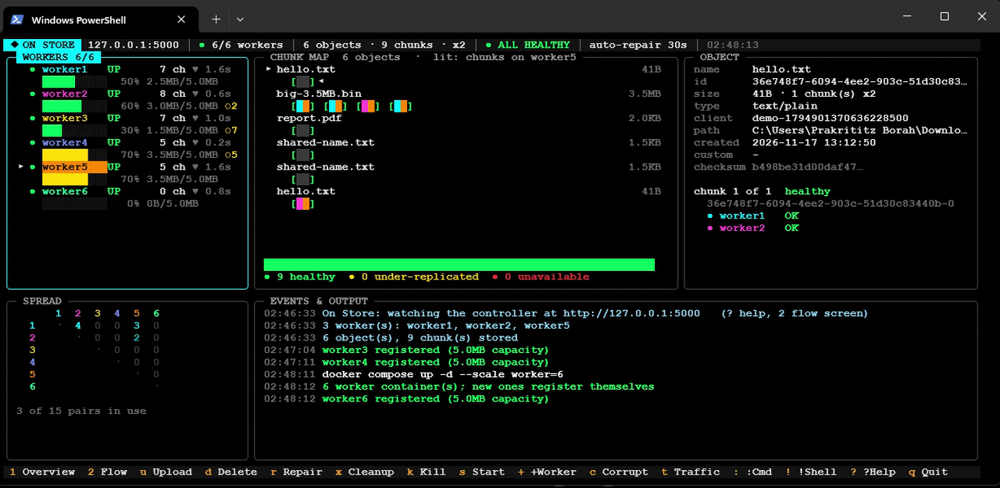
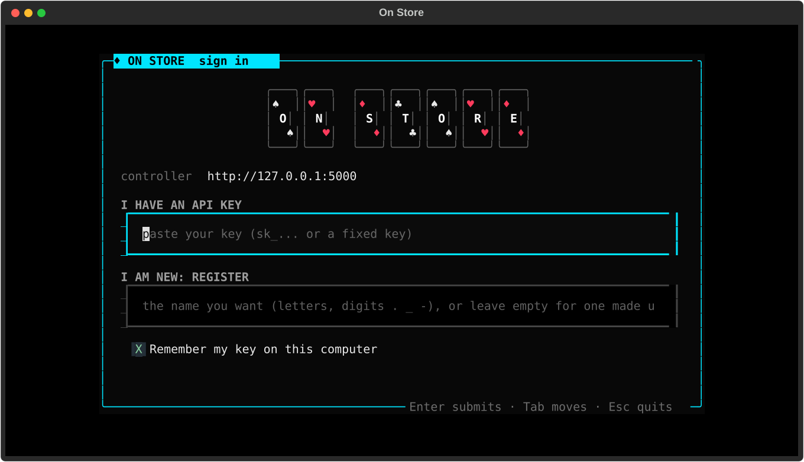
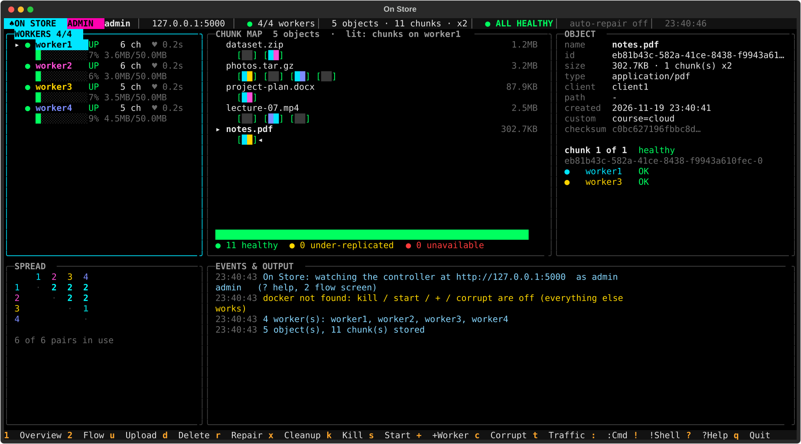
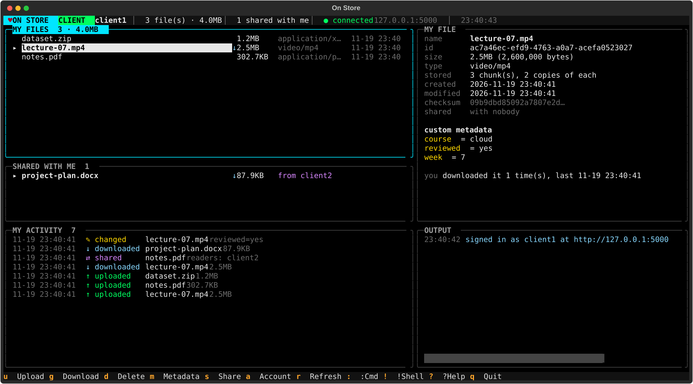

# On Store: terminal dashboards

Live terminal dashboards for the object store. It is a separate program: it reads the controller's REST API, uses the `docker` command for kill, start, add-worker and corrupt, and imports nothing from the rest of the project.

```powershell
pip install -r dashboard/requirements.txt     # once: textual + requests
docker compose up --build -d                  # the system (from the project folder)
python -m dashboard --key admin-dev-key       # the admin dashboard
python -m dashboard --key client1-dev-key     # client1's dashboard
python -m dashboard                           # the saved key, or the sign-in portal
python -m dashboard --sign-in                 # the portal even with a saved key (register, switch client)
python -m dashboard --sign-out                # forget the saved key
python -m dashboard --flow                    # admin: open on the flow screen
python -m dashboard --api http://127.0.0.1:5000   # another controller address
```



Use a real terminal (Windows Terminal, the VS Code terminal) at least 140 x 40 characters. `q` quits the dashboard; the system keeps running.

## Who sees what

The key decides which dashboard opens (`GET /api/v1/me` says whether it is an admin's):

| | Admin dashboard (On Store) | Client dashboard |
|---|---|---|
| who | a key named in `ADMINS` (or a controller without authentication) | any other key |
| files | every object of every client | its own, plus the ones shared with it |
| workers, chunk copies, heartbeats, orphans | yes | no |
| repair, cleanup, kill / start / add workers, corrupt | yes | no |
| history | events seen while it runs | its own uploads, downloads, deletes, changes and shares, kept by the controller (`GET /api/v1/me/activity`) |

The controller enforces this, not the dashboard: with a client key, the worker and repair endpoints answer 403, and other clients' objects 404.

Where the key comes from: `--key`, else `API_KEY`, else the key saved for this controller in `~/.objectstore/credentials.json` (`OBJECTSTORE_CREDENTIALS` overrides it). It is the same file and format as `python client.py register`, so a key saved by either one works in both.

## The sign-in portal



It opens when there is no key that works:

- **I have an API key**: type it and press Enter. The controller says who it belongs to.
- **I am new: register**: type the name you want, or nothing to get a made-up one, and press Enter. The controller creates your key (`POST /api/v1/clients`) and the portal shows it **once**. The controller keeps only a hash of it, so a lost key cannot be recovered. With "Remember my key" ticked (the default), it is saved to the credentials file. `c` copies it, and Enter opens your dashboard.

Registration answers you may see: the name is taken (choose another), registration is off (`ALLOW_REGISTRATION=0`: ask the admin for a key), or too many registrations from your address.

## Admin screens



- **1 Overview**
  - Workers: state, chunks, heartbeat age, usage, orphans.
  - Chunk map: each object's chunks, one coloured block per copy.
  - Selected object and chunk.
  - Spread: chunks shared by each pair of workers.
  - Events and output.
- **2 Flow**
  - Heartbeats (♥) travel from each worker to the controller.
  - Requests and data (? ■), failed requests (×), repair copies (▣).
  - A 20-second heartbeat strip per worker.
  - Failure detection with the countdown to auto-repair.
  - Repair steps, one at a time.

Everything is real. Heartbeats are found from the heartbeat ages in `GET /nodes`. Uploads from any client and copies moved by auto-repair are found by comparing the metadata between refreshes. `t` makes the dashboard download a random object every 3 s, so there is read traffic to watch.

## Admin keys

| Key | Does |
|---|---|
| `1` `2` | overview / flow |
| `Tab` `↑↓←→` `Enter` | move between panes, select, details (a worker's orphans and missing chunks; a chunk's copies) |
| `u` `d` | upload / delete the selected object |
| `r` `x` | repair / clean up orphans |
| `k` `s` `+` `c` | kill / start the selected worker, add a worker, damage a copy of the selected chunk (need docker) |
| `t` | client traffic on / off |
| `:` | command line: `upload PATH [k=v,...]`, `upload NAME MB`, `download`, `delete`, `meta k=v`, `repair`, `cleanup [MIN_AGE]`, `kill W`, `start W`, `scale N`, `corrupt [W]`, `clear`, `help` |
| `!` | shell command, output streamed into the events pane (`Ctrl+C` stops it) |
| `?` | help |

## The client dashboard



- **My files**: name, size, type, upload time. `↓` marks the ones you have downloaded.
- **Shared with me**: files other clients let you read, and whose they are.
- **File**: the selected file. Its size, type, times and checksum, how many chunks and copies it is stored as, who you shared it with, its custom metadata, and how often you downloaded it.
- **My activity**: everything you did, from this dashboard, `client.py` or curl.
- **Output**: what your commands did.

| Key | Does |
|---|---|
| `Tab` `↑↓` `Enter` | move between your files and the shared ones, select, all the details |
| `u` `g` `d` | upload / download / delete (your own files only) |
| `m` `s` | change custom metadata / share with other clients |
| `a` | your account: limits, storage, your key (`v` shows it, `c` copies it) |
| `r` | refresh now |
| `:` | command line: `upload PATH [k=v,...]`, `download [FILE] [DEST]`, `delete [FILE]`, `meta [FILE] k=v,...`, `share [FILE] client2,client3` (or `-`), `info [FILE]`, `account`, `key`, `logout`, `clear`, `help` |
| `!` | shell command, output streamed into the output pane (`Ctrl+C` stops it) |
| `?` | help |

Uploads stream from disk and downloads stream to a temporary file, as `client.py` does. A download is checked against its checksum before it is renamed into place.

## Files

| File | What it does |
|---|---|
| `__main__.py` | command-line options, finds the key, opens the portal or the right dashboard |
| `portal.py` | the sign-in and registration portal |
| `app.py` | the admin app: polling, events, keys, commands, shell |
| `client_app.py` | the client dashboard |
| `credentials.py` | the saved keys (the same file as client.py's) |
| `model.py` | plain Python: worker states, chunk health, events, heartbeat detection |
| `widgets.py` | the overview panes |
| `flow.py` | the flow screen and its animation |
| `screens.py` | help, details and confirm windows |
| `api.py` / `docker_ctl.py` | the REST API / the docker command |
| `onstore.tcss` | the look |

Tests: `tests/test_dashboard.py` covers the admin model on its own, and the real admin app driven by keyboard against the 4-worker test cluster. `tests/test_client_dashboard.py` covers the portal, the client dashboard, the admin dashboard with authentication on, and choosing between them.
